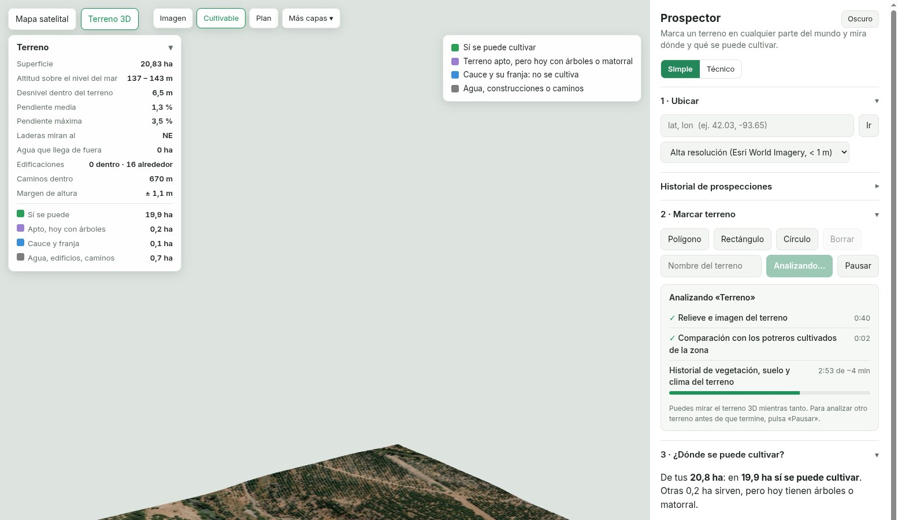
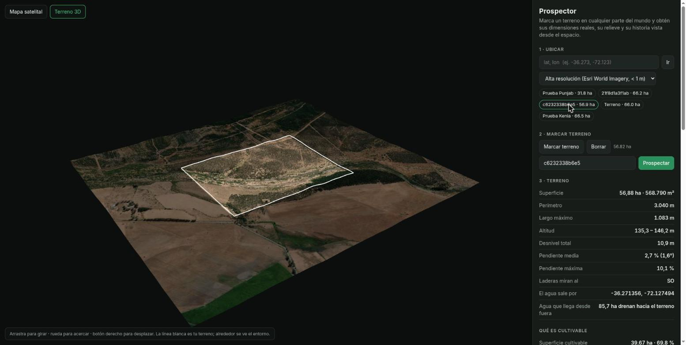
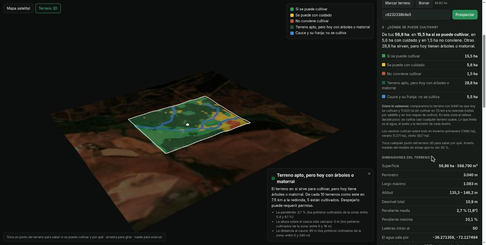
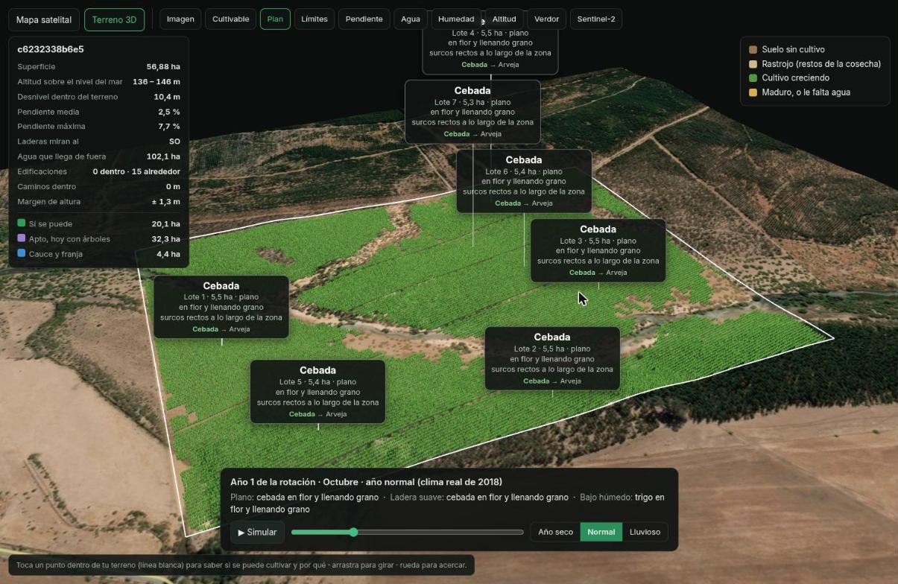
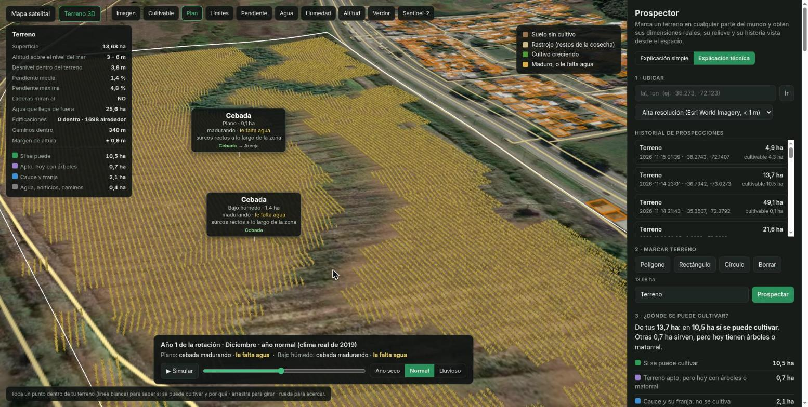
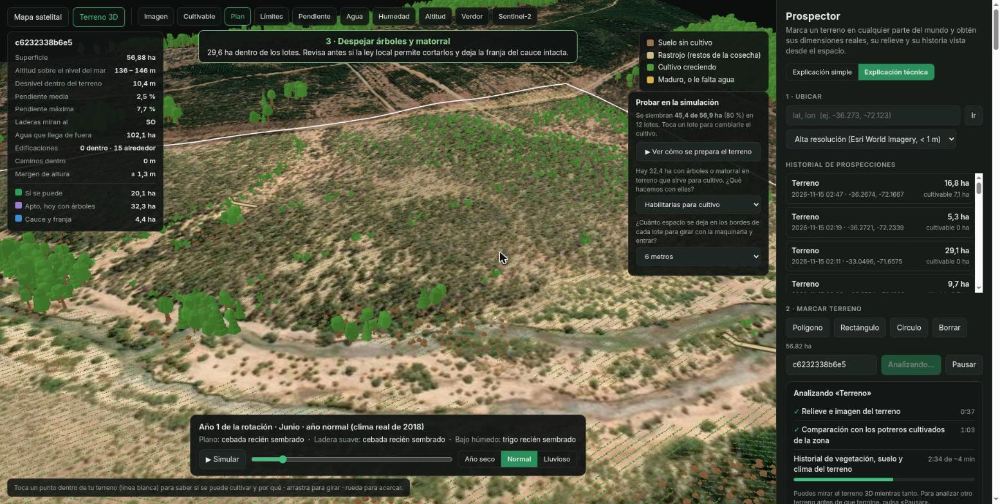
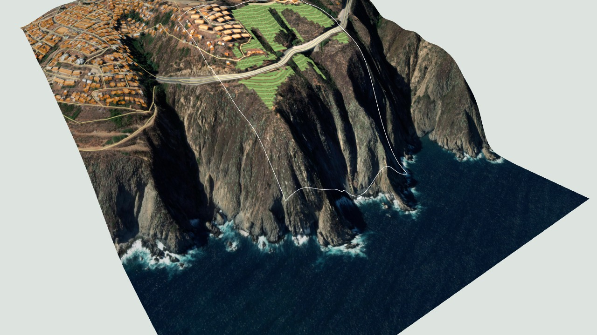
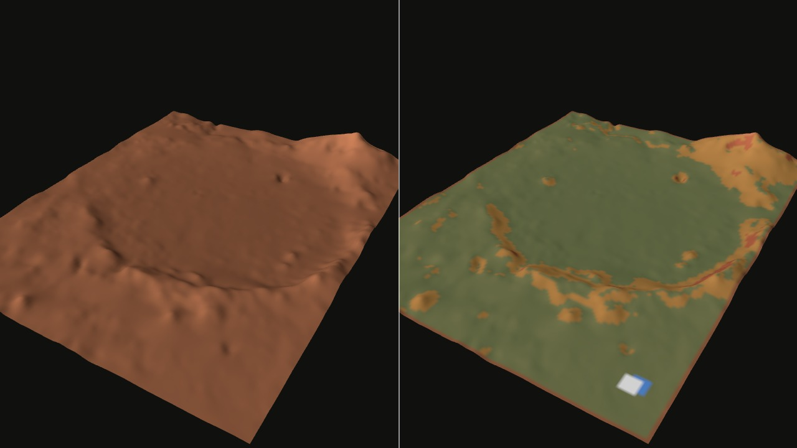

# Prospector — plan any field on Earth before you plant

NASA Space Apps Challenge 2026 · challenge **Field Shift: Adapting Farms with NASA Data** · team **RocketPower** (Chile)

**Demo:** [7 slides (PDF)](docs/demo/Prospector_RocketPower_demo.pdf) · [PowerPoint file](docs/demo/Prospector_RocketPower_demo.pptx) · [25-second video of the app running](docs/demo/Prospector_demo.mp4) · [validation](docs/VALIDATION.md)

Prospector is a decision-support tool for farmers and advisors. You draw a field on a satellite map, anywhere in the world, and it answers four questions with open NASA data:

1. **Where can I farm?** A 3D replica of the terrain, with every 10 m cell classified as suitable, suitable with care, too steep, water channel, built/road, or suitable but under trees.
2. **What grows here?** 31 annual crops simulated day by day against 24 years of weather (2001–2024): which grow without irrigation, a tentative sowing window, and how many years out of ten the harvest succeeds.
3. **How should I rotate?** The current rotation compared with alternatives by good years, water use, soil loss and months of bare soil.
4. **How do I lay the field out?** Plots, headlands, buffer strips and an access route from the nearest drivable road — after asking the farmer what to do with trees, slopes, roads and buildings.

The plan is shown on the 3D terrain month by month, in a dry, a normal and a wet year taken from the real record. Every number shows its source. The tool supports the farmer's decision; it does not replace local agronomic advice.



The side panel is a sequence of collapsible steps; only three map layers are shown at first, the rest sit under "More layers". Light and dark themes. The screenshots below were taken with the earlier dark layout.



| Where cultivation is possible | Field split into plots |
|---|---|
|  |  |

| Crops growing month by month | Clearing and first sowing |
|---|---|
|  |  |

The interface is currently in Spanish, with a simple/technical language switch.

### Reshaping the land, on Earth and beyond

| A hillside with bench terraces | Mars: Jezero crater today and with the site plan |
|---|---|
|  |  |

- **Terraces on Earth.** Where a field has slopes of 8 to 30 %, one button shows the same hillside cut into bench terraces that stay connected to the rest of the field: the step height is chosen so benches are about 8 m wide (never more than 2 m high), access ramps leave from the existing roads and climb each sector across the slope, and the edges blend into the neighbouring ground over 20 m. It reports steps, bench width, earth to move and ramp length and gradient. It is a sizing sketch on a 30 m terrain model, not a construction plan.
- **Mars and the Moon** (`/otros.html`). The user marks an area on a NASA-derived basemap; the tool reads the real elevation (MOLA 463 m for Mars, LOLA 118 m for the Moon) and, instead of flattening it, sites a station the way mission studies do: slopes are classed with the limits real missions used (5° and 15° on Mars, 6° and 10° on the Moon), the flattest place gets a landing pad of published size (100 m on Mars, 54 m on the Moon), the tool computes the material to level that pad and the days a real robotic excavator (RASSOR 2.0, 2,700 kg a day) would need, says whether levelling is worth it, places the station outside the reach of engine debris and traces a cargo access under 5°. Every limit links to its source on the page. It measures terrain shape only: no radiation, temperature, dust, light, water, ice or energy; preparing a site is not terraforming, and the page says so.

## Quick start

With Docker:

```bash
docker compose up --build        # http://localhost:8790
```

Without Docker (tested with Python 3.14):

```bash
python -m venv .venv && .venv/bin/pip install -r requirements.txt
.venv/bin/python -m uvicorn prospector.api:app --port 8790
```

Optional, once: download the global reference data (about 280 MB). Without it the app still works, but it cannot show the local crop calendar or what is actually grown nearby.

```bash
python -m prospector.obtener_datos                              # local install
docker compose exec prospector python -m prospector.obtener_datos   # Docker
```

Requirements: 2 CPU cores, 4 GB of RAM, about 4 GB of disk (the Docker image is 1.7 GB), and internet access to the open data services. No account or API key is needed.

## NASA data

| Data | Used for |
|---|---|
| [NASA POWER](https://power.larc.nasa.gov/) (MERRA-2, CERES) | Daily weather 2001–2024: temperature, radiation, humidity, wind |
| [GPM IMERG](https://gpm.nasa.gov/data/imerg) | Daily rainfall |
| [NASADEM](https://lpdaac.usgs.gov/products/nasadem_hgtv001/) | Elevation, 30 m |
| [Harmonized Landsat and Sentinel-2 (HLS)](https://hls.gsfc.nasa.gov/) | Vegetation history of the field |
| [NASA GIBS](https://www.earthdata.nasa.gov/engage/open-data-services-software/earthdata-developer-portal/gibs-api) (MODIS Terra) | Background imagery |

Partner and other open data (Copernicus DEM, Sentinel-2, ESA WorldCover and CCI, SoilGrids, WorldClim, Overture Maps, GGCMI crop calendar, CROPGRIDS, GDHY): see [docs/DATA.md](docs/DATA.md).

## Validation

The crop engine was tested on random points spread evenly over nine world regions, against independent data. On a sample of 360 points drawn after the last change to the engine and never used to adjust it:

| Measured | Result |
|---|---|
| Rainfed cropland points where the engine finds at least one crop that grows without irrigation | 94 % of 235 |
| Arid land with no cropland (under 250 mm of rain a year) where it finds one — should be zero | 0 of 27 |
| Cases where a crop is really sown (CROPGRIDS) and the engine recognises it | 97 % of 919 (81 % rainfed, 15 % only with irrigation) |
| Same question on a targeted sample: about 30 points per crop, only where that crop is grown | 94 % of 951 |

Weak spots: North Africa and the Middle East (76 %); maize, rice and cassava are missed at 8–10 % of the places where they are sown; sowing dates for peas and potatoes. The engine is permissive: a "grows" verdict is weaker evidence than a "does not grow" one. Details, the targeted sample, what each validation run changed in the engine and what the validation does not prove: [docs/VALIDATION.md](docs/VALIDATION.md).

## Known limits

- 31 annual crops are simulated (23 field crops plus tomato, pepper, onion, cabbage, watermelon, sugar beet, safflower and tobacco), with general FAO parameters. Where each crop is really grown the engine recognises it at 94 % of 951 points; it is weakest for broad bean, pepper, pea and cabbage, and the app flags those four. Fruit trees, vines and pastures are not simulated. A crop missing from the list is not a crop that fails.
- For 79 other crops (grapes, fruit, vegetables, sugar cane, coffee and more) the tool reports whether they are actually grown in the area (CROPGRIDS) and whether the area ranks among the top 10 % or 25 % of places in the world for that crop. That is observed practice — a sign of suitable climate, buyers and know-how — not a simulated yield.
- For every field the tool also shows the main crops of its first-level region (4,596 regions worldwide, CROPGRIDS summed inside Natural Earth boundaries) and of its country (official FAOSTAT harvested area, 2019–2021), so the simulation can be contrasted with what the region actually grows. Across 152 countries, the five main crops from the two sources share 4.4 crops on average and the first crop is the same in 142; at country level the two sources are not independent.
- Satellite land cover cannot tell a vineyard or an orchard from woodland. Where OpenStreetMap maps the parcel as vineyard, orchard or nursery, the tool treats it as an existing plantation: it is not proposed for clearing and is drawn as rows. Where the map has nothing, the farmer is asked.
- Sowing and harvest dates are tentative: the real date depends on the variety and the year.
- Crop parameters are general FAO values adjusted with a 55 km crop calendar, not local varieties.
- The model does not predict tonnes per hectare or income. Yields shown are measured values for the area (GDHY), where they exist.
- Terrain resolution is 30 m. Rural tracks may be missing from the road data; the user can mark the entrance by hand.
- No farmer or agronomist has reviewed the results yet.

## Documentation

- [docs/ARCHITECTURE.md](docs/ARCHITECTURE.md) — backend, frontend, crop engine and API
- [docs/DEPLOYMENT.md](docs/DEPLOYMENT.md) — running it on a server or in the cloud, and what is needed to scale
- [docs/DATA.md](docs/DATA.md) — every data source, its use and licence
- [docs/VALIDATION.md](docs/VALIDATION.md) — how the validation was done and how to rerun it

## Team

RocketPower (Chile): Fernando Gomez Solis, Fabian Guillermo Palma Rebolledo, Amaro Valdebenito Lugo, Daniel Cordero Mendoza, Santiago Eduardo Garcia-Huidobro Soto.

## Use of AI

The code and the written materials of this project were produced with the assistance of Claude (Anthropic), directed and reviewed by the team. No images, video or audio were generated with AI. The 3D models are from the Kenney Nature Kit (CC0). All data come from NASA and other open sources; no data were generated by AI. The running application does not use a generative AI model: results come from published methods (FAO-56, FAO-33, RUSLE) applied to open data.

## Licence

Code: [MIT](LICENSE). Third-party components and data keep their own licences: [THIRD_PARTY.md](THIRD_PARTY.md).
